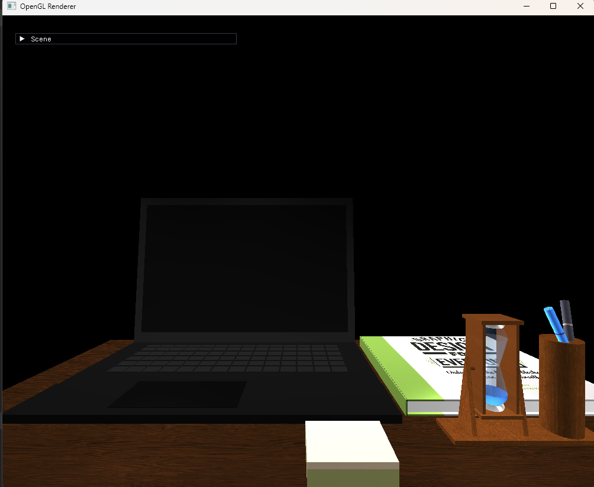
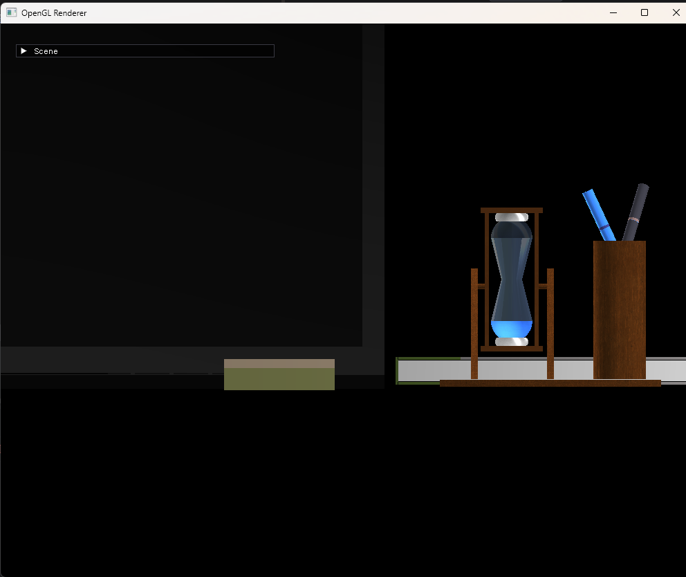

# OpenGL Renderer

Graphics Renderer based on OpenGL rendering a scene based on primitives.

*Done as part of SNHU CS330.*

## Screenshots

## Prerequisites

Ensure the following tools are installed and available in your system PATH:

* CMake (3.25+): Build system generator.
* Clang-Format: Required for automated code style enforcement.

## CMake Configuration

* **IMGUI_DEBUG_WINDOW**: Enables IMGUI Debug Window. ON by default when using CMakePresets.

## Getting Started

Open the project as either a CMake Project in an IDE like CLion or Visual Studio.

**OR**

* Run `cmake -b build`
* Run `cmake --build build`
* Run `build/src/OpenGLRenderer.exe`

## Navigation

* W, S, A, D - Move forward, backward, left, and right
* Q, E - Move up and down
* Mouse Scroll - Forward to decrease speed. Backward to increase speed.
* Mouse Movement - Look around
* Esc - Exit application
* O - Orthographic Projection
* P - Perspective Projection

## Project Reflection

### How do I approach designing software?

A primary challenge I previously faced in software design was scope creep. By adhering to a strict timeline and focusing
on the specific requirements of replicating a 2D image in 3D space, I was able to produce a competent, fully realized
application without letting the feature set expand uncontrollably.

A key design tactic I employed was decoupling the rendering loop from the primitive loading logic. While I did not go as
far as building a full scene graph, this structural division kept the project within the time budget while enabling me
to quickly swap and add new shapes to the scene. I plan to apply this principle of modular separation to all future
software architectures, ensuring my code remains scalable and maintainable.

### How do I approach developing programs?

To accelerate the development process, I integrated `DearImGui` to create a custom debug interface. This strategy allowed
me to visually manipulate primitive transforms and iterate on the layout in real-time, completely bypassing the need to
recompile the C++ code for every minor positional adjustment.

My approach to development evolved into a highly iterative pipeline throughout the milestones. Rather than modeling all
the geometry first and saving lighting for the end, I utilized a vertical slice method: taking a single object through
the entire pipeline, primitive building, texturing, and lighting, before moving to the next. Because the project was
broken down into distinct milestones, I was able to incorporate instructor feedback at each stage. This prevented me
from feeling overwhelmed by the sheer scale of the project and kept development moving progressively forward.

### How can computer science help me in reaching my goals?

Computer science, engineering, and electronics have always been my passions, and designing 3D models and picturesque
scenes is an incredibly rewarding extension of that. My ultimate professional goal is to join a custom game engine
development team, which I view as the perfect culmination of technical logic and creative expression.

Studying computational graphics and visualizing the mathematics behind the legacy Phong lighting model has provided me
with a deep, foundational understanding of the rendering pipeline. While the modern industry has largely shifted toward
more explicit graphics APIs like Vulkan, the core concepts of rasterization, vector mathematics, shader implementation,
and memory management I learned in this course will translate directly into my future educational and professional
pursuits.